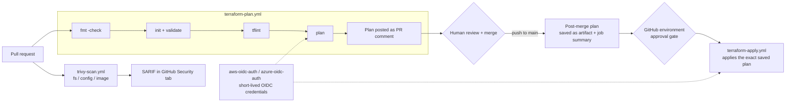

# platform-workflows

[](https://github.com/Krustytoe/platform-workflows/actions/workflows/ci.yml) [](https://github.com/Krustytoe/platform-workflows/releases/latest) [](LICENSE)

Reusable GitHub Actions workflows and composite actions for Terraform, security scanning, and cloud authentication. Designed for teams running on AWS (commercial + GovCloud) and Azure (commercial + Government).

## Architecture



## Design decisions

- **No long-lived cloud credentials anywhere.** Both clouds authenticate through OIDC federation; there are no access keys or client secrets to store, rotate, or leak.
- **The approval gate lives in GitHub environments, not in workflow logic.** Required reviewers are configured per environment in repo settings, so approvals have an audit trail and can't be bypassed by editing YAML in a PR. The apply job declares the environment itself, which also scopes the OIDC subject claim to `environment:<name>`.
- **What gets approved is what gets applied.** The post-merge plan is saved as a short-lived artifact and shown in the run's job summary; the approver reviews it at the environment gate, and apply runs that exact plan file. If state drifted in between, Terraform rejects the stale plan instead of applying something nobody saw.
- **Plans are reviewable where the change is reviewed.** The plan lands as a collapsible PR comment, so approvers see infrastructure impact next to the code diff.
- **Least-privilege tokens.** Each workflow declares only the `permissions` it needs; the scan job gets only `contents: read` and `security-events: write`.
- **Supply-chain pinning.** Third-party actions are pinned to full commit SHAs with the version as a comment, so Dependabot can propose bumps as reviewable PRs. The reusable workflows inline the steps of this repo's composite actions instead of calling them, so a released workflow never pulls in unreleased code from `main`. Callers pin this repo by SHA.
- **Scan findings are visible, not build-breaking, by default.** Trivy results go to the Security tab as SARIF, so teams can triage against a remediation SLA instead of having pipelines blocked by a newly published CVE.

## Versioning

Releases are cut by [release-please](https://github.com/googleapis/release-please) from conventional commits. Pin callers to a release tag (shown below), or to its commit SHA with the tag as a comment so Dependabot can bump it:

```yaml
uses: Krustytoe/platform-workflows/.github/workflows/trivy-scan.yml@<sha> # v0.1.0
```

Avoid `@main`: any merge here would immediately change every caller's pipeline. The reusable workflows follow the same rule internally: they don't call this repo's composite actions (a workflow can't pin its own repo to its own SHA), they inline those steps with every third-party action SHA-pinned.

## Contents

| Type | Name | What it does |
|---|---|---|
| Reusable workflow | [`terraform-plan`](#terraform-plan) | fmt → init → validate → tflint → plan; posts plan to the PR and job summary, optionally saves it for apply |
| Reusable workflow | [`terraform-apply`](#terraform-apply) | Applies the exact reviewed plan, behind a GitHub environment approval gate |
| Reusable workflow | [`trivy-scan`](#trivy-scan) | Trivy scan on filesystem/IaC or container image; uploads SARIF to GitHub Security |
| Composite action | [`aws-oidc-auth`](#aws-oidc-auth) | OIDC auth to AWS — no long-lived keys |
| Composite action | [`azure-oidc-auth`](#azure-oidc-auth) | OIDC auth to Azure — no client secrets |
| Composite action | [`terraform-setup`](#terraform-setup) | Install Terraform + tflint at consistent versions |

---

## terraform-plan

Runs `fmt -check → init → validate → tflint → plan` and posts the plan output as a collapsible PR comment and to the run's job summary. With `upload_plan: true` it saves the plan file as an artifact (1-day retention) for `terraform-apply`. Supports AWS and Azure; leave `cloud` empty for local/offline validation.

```yaml
jobs:
  plan:
    uses: Krustytoe/platform-workflows/.github/workflows/terraform-plan.yml@v0.3.0 # x-release-please-version
    permissions:
      contents: read
      id-token: write
      pull-requests: write
    with:
      working_directory: deploy/terraform
      cloud: aws
      aws_region: us-gov-west-1
    secrets:
      AWS_ROLE_ARN: ${{ secrets.AWS_ROLE_ARN }}
```

| Input | Type | Default | Description |
|---|---|---|---|
| `working_directory` | string | **required** | Path to the Terraform config, relative to repo root |
| `terraform_version` | string | `~1.10` | Version constraint |
| `cloud` | string | `""` | `aws`, `azure`, or empty |
| `aws_region` | string | `""` | Required when `cloud = aws` |
| `upload_plan` | boolean | `false` | Save the plan as an artifact (only when it has changes) |
| `plan_artifact_name` | string | `tfplan` | Artifact name; make it unique per working directory in a run |

| Output | Description |
|---|---|
| `has_changes` | `"true"` when the plan has changes; use it to skip apply on no-op plans |

| Secret | Required | Description |
|---|---|---|
| `AWS_ROLE_ARN` | When AWS | IAM role ARN to assume via OIDC |
| `AZURE_CLIENT_ID` | When Azure | Managed identity client ID |
| `AZURE_TENANT_ID` | When Azure | Azure tenant ID |
| `AZURE_SUBSCRIPTION_ID` | When Azure | Azure subscription ID |

---

## terraform-apply

Runs `init → apply <saved plan>` inside a [GitHub environment](https://docs.github.com/en/actions/deployment/targeting-different-environments), so the environment's required reviewers approve before anything changes. GitHub doesn't allow `environment:` on a job that *calls* a reusable workflow, so pass it as an input.

```yaml
jobs:
  apply:
    needs: plan
    if: needs.plan.outputs.has_changes == 'true'
    uses: Krustytoe/platform-workflows/.github/workflows/terraform-apply.yml@v0.3.0 # x-release-please-version
    permissions:
      contents: read
      id-token: write
    with:
      working_directory: deploy/terraform
      environment: prod                # approval gate + OIDC sub claim environment:prod
      plan_artifact_name: tfplan       # from terraform-plan with upload_plan: true
      cloud: aws
      aws_region: us-gov-west-1
    secrets:
      AWS_ROLE_ARN: ${{ secrets.AWS_ROLE_ARN }}
```

| Input | Type | Default | Description |
|---|---|---|---|
| `working_directory` | string | **required** | Same directory the plan ran in |
| `environment` | string | **required** | GitHub environment whose protection rules gate the apply |
| `plan_artifact_name` | string | `""` | Plan artifact from this run. If empty, applies a fresh unreviewed plan and logs a warning |
| `terraform_version` | string | `~1.10` | Must match the version that produced the plan |
| `cloud` / `aws_region` | string | `""` | Same as `terraform-plan` |

Secrets are identical to `terraform-plan`.

---

## trivy-scan

Runs Trivy against a filesystem/IaC path or container image and uploads the results to GitHub Security as SARIF.

```yaml
jobs:
  scan:
    uses: Krustytoe/platform-workflows/.github/workflows/trivy-scan.yml@v0.3.0 # x-release-please-version
    permissions:
      contents: read
      security-events: write
    with:
      scan_type: fs
      target: .
      severity: HIGH,CRITICAL
```

| Input | Type | Default | Description |
|---|---|---|---|
| `scan_type` | string | `fs` | `fs` (vulnerabilities/secrets), `config` (IaC misconfiguration), or `image` |
| `target` | string | `.` | Path for `fs`/`config`; image reference for `image` |
| `severity` | string | `HIGH,CRITICAL` | Severities to report |
| `upload_sarif` | boolean | `true` | Upload SARIF to GitHub Security tab |

---

## aws-oidc-auth

```yaml
- uses: Krustytoe/platform-workflows/actions/aws-oidc-auth@v0.3.0 # x-release-please-version
  with:
    role_arn: ${{ secrets.AWS_ROLE_ARN }}
    region: us-gov-west-1
```

Wraps `aws-actions/configure-aws-credentials`. Requires `id-token: write` permission on the calling job.

---

## azure-oidc-auth

```yaml
- uses: Krustytoe/platform-workflows/actions/azure-oidc-auth@v0.3.0 # x-release-please-version
  with:
    client_id: ${{ secrets.AZURE_CLIENT_ID }}
    tenant_id: ${{ secrets.AZURE_TENANT_ID }}
    subscription_id: ${{ secrets.AZURE_SUBSCRIPTION_ID }}
```

Wraps `azure/login`. Requires `id-token: write` permission on the calling job.

---

## terraform-setup

```yaml
- uses: Krustytoe/platform-workflows/actions/terraform-setup@v0.3.0 # x-release-please-version
  with:
    terraform_version: "~1.10"
```

Installs Terraform and tflint, then runs `tflint --init` to download configured plugins.

---

## Tying it together

A full plan-then-apply flow for a Terraform repo. PRs get a plan comment; after merge, the plan is re-run against `main`, saved, and applied only after an environment reviewer approves it.

```yaml
on:
  pull_request:
  push:
    branches: [main]

jobs:
  plan:
    uses: Krustytoe/platform-workflows/.github/workflows/terraform-plan.yml@v0.3.0 # x-release-please-version
    permissions:
      contents: read
      id-token: write
      pull-requests: write
    with:
      working_directory: deploy/terraform
      cloud: aws
      aws_region: us-gov-west-1
      upload_plan: ${{ github.event_name == 'push' }}
    secrets:
      AWS_ROLE_ARN: ${{ secrets.AWS_PLAN_ROLE_ARN }}     # read-only role

  apply:
    needs: plan
    if: github.event_name == 'push' && needs.plan.outputs.has_changes == 'true'
    uses: Krustytoe/platform-workflows/.github/workflows/terraform-apply.yml@v0.3.0 # x-release-please-version
    permissions:
      contents: read
      id-token: write
    with:
      working_directory: deploy/terraform
      environment: prod
      plan_artifact_name: tfplan
      cloud: aws
      aws_region: us-gov-west-1
    secrets:
      AWS_ROLE_ARN: ${{ secrets.AWS_APPLY_ROLE_ARN }}    # write role
```

**Use separate roles for plan and apply.** The two jobs present different OIDC subject claims, so each role's trust policy can be scoped tightly:

| Job | OIDC `sub` claim | Role |
|---|---|---|
| plan (PR) | `repo:<org>/<repo>:pull_request` | Read-only |
| plan (after merge) | `repo:<org>/<repo>:ref:refs/heads/main` | Read-only |
| apply | `repo:<org>/<repo>:environment:prod` | Write; only reachable through the approval gate |

## License

MIT
